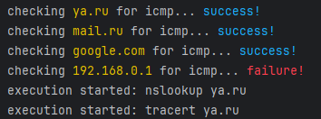
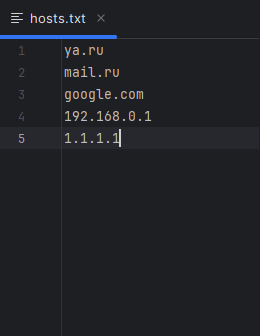
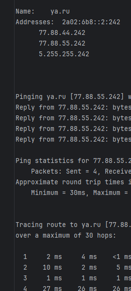

<h1>PYPINGER</h1>
Инструмент для диагностики и быстрой проверки нескольких хостов в многопоточном режиме

<h1>Как работает?</h1>
<ul>
<li> Файл <b><i>hosts.txt</i></b> содержит список проверяемых хостов (ip или dns), располагаются построчно, количество не ограничено но должно быть в разумных пределах (до 32)
<li> Запускается <b><i>tracert, ping, nslookup</i></b> для каждого хоста
<li> Если нет ответа на пинг - пропускаем. Если пинги проходят, значит отправляем много пакетов и разного размера (можно регулировать и выставлять разные значения)
<li> Вывод результатов осуществляется в директорию <b><i>output</i></b> (создается автоматически, если отсутствует). Для каждого хоста создается отдельный файл (если он уже есть, старые результаты затираются новыми). По завершении хотя бы одной из команд, результат сразу пишется в файл. Прогресс отслеживать нельзя, но в консоли будут сообщения о начатых/завершенных командах
<li> Предусмотрен вывод системной информации (ipconfig + route) в отдельный файл <b><i>netinfo.txt</i></b>
</ul>

<h1>Преимущества</h1>
<ul>
<li> Главное преимущество - это многопоточность, команды выполняются независимо друг от друга, что сильно повышает скорость получения результата
<li> Автоматизирует рутинные операции, вручную это осуществимо, но крайне накладно
<li> Запись по файлам позволяет наглядно увидеть результат
<li> Для старта нужно лишь указать список конечных хостов и нажать запуск
<li> Код прозрачен, оптимизирован, не перегружен, прост для модификаций и правок. Подробные комментарии и описание
</ul>

<h1>Недостатки</h1>
<ul> 
<li> Отсутствует трассировка с пингами до каждого узла, что позволило бы сразу определить проблемный узел и где он находится
<li> Отсутствует графическая оболочка, нельзя отслеживать прогресс выполнения команд
<li> Могут быть ошибки связанные с кодировкой
</ul>

 

